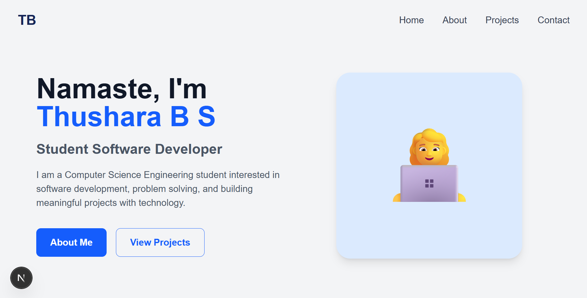
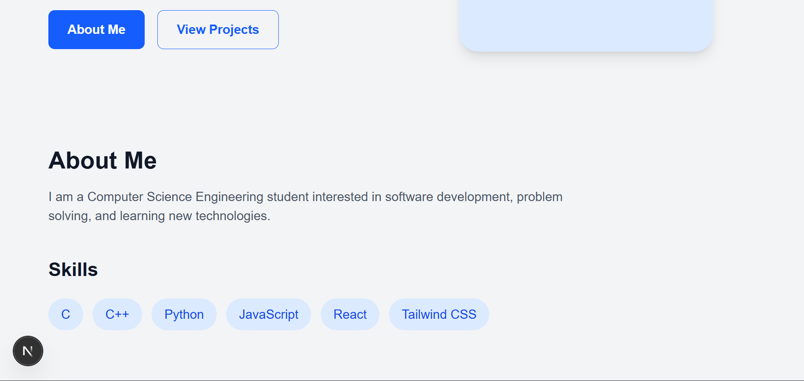

# Thushara B S — Portfolio 2

This is a personal portfolio prototype built with Next.js, React, and Tailwind CSS. It currently includes an introduction/hero area, an About Me section, and a set of skill tags.

## Preview




## Requirements

- Node.js (a current LTS release is recommended)
- npm, which is included with Node.js

## Run locally

From this folder, install dependencies and start the development server:

```sh
npm install
npm run dev
```

Open [http://localhost:3000](http://localhost:3000). The page refreshes as you edit the source.

## Available scripts

| Command | Description |
| --- | --- |
| `npm run dev` | Start the local development server. |
| `npm run build` | Create a production build. |
| `npm start` | Serve the production build (run `npm run build` first). |
| `npm run lint` | Check the project with ESLint. |

## Project structure

```text
Portfolio 2/
├── public/             # Static files served from the site root
├── src/
│   └── app/
│       ├── globals.css # Global styles and Tailwind CSS import
│       ├── layout.js   # Root layout, fonts, and page metadata
│       └── page.js     # Portfolio page content
├── eslint.config.mjs   # ESLint configuration
├── jsconfig.json       # JavaScript project configuration
├── package.json        # Dependencies and npm scripts
├── package-lock.json   # Locked npm dependency versions
└── next.config.mjs     # Next.js configuration
```

## Customize

- Update the portfolio content, navigation labels, and skills in `src/app/page.js`.
- Adjust global styles and Tailwind theme values in `src/app/globals.css`.
- Change the document title and description in the `metadata` export in `src/app/layout.js`.
- Put images and other static files in `public/` and reference them with root-relative URLs.
